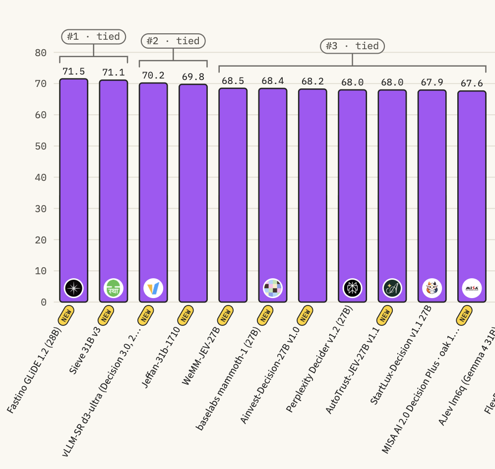

# Sieve

**Decision models that score a fixed set of answers instead of generating text.**

[](LICENSE)
[](https://huggingface.co/collections/sthanika-ai/sieve-6abb93a61dd495f69811c586)
[](https://huggingface.co/spaces/multimodalart/jev-decision-index)

Give a Sieve model a state (text or JSON) and typed questions, and it returns a probability for every option of every question. Use it wherever a product step is a decision rather than writing: routing a ticket, classifying a document, checking a request against a policy, picking a tool. This repository holds the code for every model; weights, model cards and results are in the [Sieve collection](https://huggingface.co/collections/sthanika-ai/sieve-6abb93a61dd495f69811c586).

🏆 **[Sieve-31B-v3](https://huggingface.co/sthanika-ai/Sieve-31B-v3) is ranked #1 (tied) on the [Decision Index leaderboard](https://huggingface.co/spaces/multimodalart/jev-decision-index)**, with a Full score of 71.10 (edition 0.4.1, 2026-10-28).



## Features

- **Answers that always parse.** The caller supplies the options and every option gets a probability.
- **Calibrated.** Temperatures fitted on held-out data make a probability usable as a threshold (Sieve-31B-v2 and Sieve-31B use their training temperature).
- **Fast.** Nothing is generated: the options are scored directly, and many questions share one request.
- **Flexible.** Up to 255 options per question, changeable on every request; questions about one state never see each other.
- **One interface.** The same Python calls, HTTP server and benchmark engine for every model.

## Quick start

```bash
pip install -r https://raw.githubusercontent.com/sthanika-ai/Sieve/main/requirements.txt   # the tested versions (Python 3.12+)
pip install "sieve-decisions[serve] @ git+https://github.com/sthanika-ai/Sieve"
```

```python
from sieve import load_sieve, decide

m = load_sieve("sthanika-ai/Sieve-9B-v2")      # any model below, or a local folder; this one needs about 20 GB of GPU memory
decide(m,
    state={"subject": "Duplicate charge on invoice 4411",
           "body": "Billed twice for March. Refund today or we cancel the annual contract."},
    questions={
        "department": {"type": "choice", "instructions": "Which team handles this?",
                       "criteria": {"billing": "invoices, payments, refunds", "technical": "bugs and outages",
                                    "sales": "pricing and contracts"}},
        "urgency":    {"type": "score", "instructions": "How urgent is this?",
                       "criteria": ["can wait", "this week", "today"]},
        "churn_risk": {"type": "noul", "instructions": "Does the customer threaten to cancel?"},
    })
```

```json
{
  "department": {"type": "choice", "choice": "billing", "confidence": 0.9851,
                 "probabilities": {"billing": 0.9901, "technical": 0.0001, "sales": 0.0098}},
  "urgency":    {"type": "score", "score": 1.8808, "legend": {"0": "can wait", "1": "this week", "2": "today"},
                 "confidence": 0.8213, "probabilities": {"0": 0.0111, "1": 0.0969, "2": 0.892}},
  "churn_risk": {"type": "noul", "noul": 0.9938}
}
```

[`examples/quickstart.py`](examples/quickstart.py) runs this request.

## Models

| Model | Backbone | Design | Full score | Public score | GPU memory (bf16) | Weights |
|---|---|---|--:|--:|--:|---|
| Sieve-31B-v3 | [Gemma-4-31B-it](https://huggingface.co/google/gemma-4-31B-it) | letter readout | **71.10** | [71.68](https://huggingface.co/datasets/sthanika-ai/Sieve-31B-v3-decision-index-results) | 58 GiB | [`sthanika-ai/Sieve-31B-v3`](https://huggingface.co/sthanika-ai/Sieve-31B-v3) |
| Sieve-31B-v2 | [Gemma-4-31B-it](https://huggingface.co/google/gemma-4-31B-it) | answer slots | – | [69.97](https://huggingface.co/datasets/sthanika-ai/Sieve-31B-v2-decision-index-results) † | 84 GB | [`sthanika-ai/Sieve-31B-v2`](https://huggingface.co/sthanika-ai/Sieve-31B-v2) |
| Sieve-31B | [Gemma-4-31B-it](https://huggingface.co/google/gemma-4-31B-it) | answer slots | 64.25 ‡ | [62.52](https://huggingface.co/datasets/sthanika-ai/Sieve-31B-decision-index-results) | 83 GB | [`sthanika-ai/Sieve-31B`](https://huggingface.co/sthanika-ai/Sieve-31B) |
| Sieve-27B-v2 | [Qwen3.8-27B](https://huggingface.co/Qwen/Qwen3.8-27B) | pointer head | **59.89** | [68.02](https://huggingface.co/datasets/sthanika-ai/Sieve-27B-v2-decision-index-results) | 52 GB | [`sthanika-ai/Sieve-27B-v2`](https://huggingface.co/sthanika-ai/Sieve-27B-v2) |
| Sieve-27B | [Qwen3.8-27B](https://huggingface.co/Qwen/Qwen3.8-27B) | pointer head | 60.17 ‡ | [60.04](https://huggingface.co/datasets/sthanika-ai/Sieve-27B-decision-index-results) | 55 GB | [`sthanika-ai/Sieve-27B`](https://huggingface.co/sthanika-ai/Sieve-27B) |
| Sieve-9B-v2 | [Qwen3.5-9B](https://huggingface.co/Qwen/Qwen3.5-9B) | pointer head | **47.00** | [53.35](https://huggingface.co/datasets/sthanika-ai/Sieve-9B-v2-decision-index-results) | 20 GB | [`sthanika-ai/Sieve-9B-v2`](https://huggingface.co/sthanika-ai/Sieve-9B-v2) |
| Sieve-9B | [Qwen3.5-9B](https://huggingface.co/Qwen/Qwen3.5-9B) | pointer head | **41.73** | [41.88](https://huggingface.co/datasets/sthanika-ai/Sieve-9B-decision-index-results) | 20 GB | [`sthanika-ai/Sieve-9B`](https://huggingface.co/sthanika-ai/Sieve-9B) |
| Sieve-4B | [Qwen3.5-4B](https://huggingface.co/Qwen/Qwen3.5-4B) | option codes | **40.96** | [50.06](https://huggingface.co/datasets/sthanika-ai/Sieve-4B-decision-index-results) | 10 GB | [`sthanika-ai/Sieve-4B`](https://huggingface.co/sthanika-ai/Sieve-4B) |
| Sieve-2B-v3 | [Qwen3.5-2B](https://huggingface.co/Qwen/Qwen3.5-2B) | pointer head | **34.45** | [53.51](https://huggingface.co/datasets/sthanika-ai/Sieve-2B-v3-decision-index-results) | 5–11 GB | [`sthanika-ai/Sieve-2B-v3`](https://huggingface.co/sthanika-ai/Sieve-2B-v3) |
| Sieve-2B-v2 | [Qwen3.5-2B-Base](https://huggingface.co/Qwen/Qwen3.5-2B-Base) | option fork | 30.84 ‡ | [37.26](https://huggingface.co/datasets/sthanika-ai/Sieve-2B-v2-decision-index-results) | a few GB | [`sthanika-ai/Sieve-2B-v2`](https://huggingface.co/sthanika-ai/Sieve-2B-v2) |
| Sieve-2B | [Qwen3.5-2B-Base](https://huggingface.co/Qwen/Qwen3.5-2B-Base) | option fork | **21.90** | [22.16](https://huggingface.co/datasets/sthanika-ai/Sieve-2B-decision-index-results) | a few GB | [`sthanika-ai/Sieve-2B`](https://huggingface.co/sthanika-ai/Sieve-2B) |
| Sieve-0.8B | [Qwen3.5-0.8B-Base](https://huggingface.co/Qwen/Qwen3.5-0.8B-Base) | option fork | **20.82** | [32.26](https://huggingface.co/datasets/sthanika-ai/Sieve-0.8B-decision-index-results) | a few GB | [`sthanika-ai/Sieve-0.8B`](https://huggingface.co/sthanika-ai/Sieve-0.8B) |

Scores are from the [Decision Index leaderboard](https://huggingface.co/spaces/multimodalart/jev-decision-index), edition 0.4.1 (2026-10-28); each Public score links to the full results. † Our own run of the public suite; not on the leaderboard yet. ‡ Replaced on the leaderboard by its successor; last score shown (Sieve-31B: 0.4.1 of 2026-10-26; Sieve-27B and Sieve-2B-v2: 0.3.2 of 2026-10-14).

Sieve-31B-v3 runs shorter requests on an 80 GB GPU and every public Decision Index request on a 96 GB GPU (the serving benchmark's peak was 81.4 GiB allocated, over 352 public requests including the largest by the kit's size estimate). Sieve-31B-v2 and Sieve-31B need a 96 GB GPU, or two GPUs with `split`.

**Sieve-Vision.** [Sieve-Vision-27B](https://huggingface.co/sthanika-ai/Sieve-Vision-27B) (Full score 65.19, CC BY-NC 4.0) and [Sieve-Vision-4B](https://huggingface.co/sthanika-ai/Sieve-Vision-4B) (58.60) answer multiple-choice questions about images, on the Decision Index vision leaderboard (edition 0.4, 2026-10-28). Their code is in their own model repositories.

## Installation

The quick start installs the tested versions from [`requirements.txt`](requirements.txt): torch 2.8.0, built for CUDA 12.8, which also runs on CUDA 12 drivers from 12.4. They need Python 3.12 or later (numpy 2.5.3); on Python 3.10 or 3.11, install without the pinned versions (below).

| To | Run |
|---|---|
| Speed up the Qwen backbones (recommended; needs nvcc 11.6+) | `pip install ninja packaging wheel setuptools && pip install --no-build-isolation causal-conv1d==1.7.0` |
| Run Sieve-31B-v2 or Sieve-31B | `pip install --no-deps decider-ai==1.6.0` |
| Install from a clone | `pip install -r requirements.txt && pip install -e .` |
| Install without the pinned versions | Install the torch build for your NVIDIA driver, then `pip install "sieve-decisions[cuda,serve,slots] @ git+https://github.com/sthanika-ai/Sieve"` |

- Without `causal-conv1d`, transformers uses a slower PyTorch path; probabilities can differ by up to 0.006.
- The 31B models run on torch 2.8.0. With newer torch, Sieve-31B and Sieve-31B-v2 run out of memory past about 16,000 tokens on a 96 GB GPU.
- The newest torch on PyPI needs a CUDA 13 driver.

## Usage

### Python

```python
from sieve import load_sieve, decide

m = load_sieve(model, device="cuda", temperature=None, **options)
answers = decide(m, state, questions)
```

| Argument | Description |
|---|---|
| `model` | A Hugging Face repo id or a local folder. The design is read from the model's files. |
| `device` | `"cuda"` (default), or a GPU such as `"cuda:1"`. |
| `temperature` | Overrides the calibrated temperatures; `1.0` gives raw probabilities. At least 0.001. Pointer-head models also take it per call in `decide`. |
| `split` | Sieve-31B-v2 and Sieve-31B on two GPUs, e.g. `split='{"0": "40GiB", "1": "40GiB"}'`. |
| `max_tokens` | Sieve-31B-v3: refuse prompts longer than this. There is no limit by default. |

`state` is text, a JSON object or a list. A request a model cannot answer raises `ValueError`; nothing is ever truncated.

### Questions

| Type | `criteria` | Answer fields |
|---|---|---|
| `choice` | `{"key": "description" or null}`, 2–255 options with non-empty keys | `choice`, `confidence`, `probabilities` (per key) |
| `noul` | omitted, or `{"true": ..., "false": ...}` | `noul`: the probability of yes |
| `score` | a list of 2–10 distinct levels, lowest first | `score` (expected level, 0 to L−1), `legend`, `confidence`, `probabilities` (per level) |

- Every question needs non-empty `instructions`; a bare number is read as its text.
- `confidence` runs from 0 (no preference) to 1 (certain). All numbers are rounded to 4 decimals.
- The option-fork models (Sieve-2B-v2, Sieve-2B, Sieve-0.8B) do not answer `score`, and refuse two options with the same text.
- Sieve-31B-v3, Sieve-27B-v2 and Sieve-2B-v3 answer `score`, but were trained on `choice` and `noul` questions only.

### Token limits

| Models | Limit |
|---|---|
| Sieve-27B-v2, Sieve-27B, Sieve-9B-v2, Sieve-2B-v3 | 16,384 tokens of state and 16,384 per question with its options |
| Sieve-9B | 8,192 tokens of state and 8,192 per question with its options |
| Sieve-2B-v2, Sieve-2B, Sieve-0.8B | 32,768 tokens for the state, the question and the longest option |
| Sieve-4B | 32,768 tokens for the state and the longest question; 65,536 per request |
| Sieve-31B-v2, Sieve-31B | 32,768 tokens per question's prompt |
| Sieve-31B-v3 | No limit by default (set one with `max_tokens`). Trained on prompts of up to 16,384 tokens; public Decision Index prompts of over 69,000 tokens ran on one 96 GB GPU. |

A request over a limit is refused, never truncated.

### HTTP server

```bash
sieve-serve --model sthanika-ai/Sieve-27B-v2 --graphs --port 8020
curl -s localhost:8020/v1/decide -H 'content-type: application/json' -d '{"state": "Billed twice. Refund today or we cancel.",
  "questions": {"urgency": {"type": "score", "instructions": "How urgent?", "criteria": ["can wait", "this week", "today"]}}}'
```

| Endpoint | Description |
|---|---|
| `POST /v1/decide` | `{"state", "questions", "temperature"?}` returns `{"answers", "usage", "latency_ms"}`. A refused request returns HTTP 422. |
| `GET /v1/models` | The model and its design; for a pointer-head model also its temperatures and cache state. |

- `--model` takes any Sieve model; `--host` and `--port` set the address (default `127.0.0.1:8020`).
- Pointer-head models cache the last 8 states of 64 tokens or more, and `--graphs` replays short requests as CUDA graphs.
- Sieve-4B also has its own server with a state cache: `python -m sieve.codes.server --ckpt sthanika-ai/Sieve-4B --port 8123` (`/v1/systemone`, same rules and answers).

## Evaluation

```bash
sieve-eval --model sthanika-ai/Sieve-27B-v2 --data benchmark.jsonl --out result.json
python -m decision_index run --engine sieve.decision_index_engine:SieveEngine --option model=sthanika-ai/Sieve-27B-v2 --out runs/Sieve-27B-v2
```

- `sieve-eval` scores a pointer-head model on your own labelled requests: accuracy, NLL, Brier, ECE and errors at high confidence.
- Every model runs on the official [Decision Index kit](https://github.com/apolinario/decision-index) through `sieve.decision_index_engine`; build the kit's suite first, as its README describes.
- Details: [`docs/evaluation.md`](docs/evaluation.md).

## How it works

| Design | Models | How the options are scored |
|---|---|---|
| Pointer head | Sieve-27B-v2, Sieve-27B, Sieve-9B-v2, Sieve-9B, Sieve-2B-v3 | A pointer head scores the end of each option against the decision point; each question runs from the state's cache. |
| Option fork | Sieve-2B-v2, Sieve-2B, Sieve-0.8B | Each option is scored as its own continuation of the encoded state and question, so option order cannot matter. |
| Option codes | Sieve-4B | The options are listed under codes and a 255-way head reads the decision point. |
| Letter readout | Sieve-31B-v3 | The model's own output logits for the option letters, read at an answer slot per question. |
| Answer slots | Sieve-31B-v2, Sieve-31B | Each question in the chat template, scored at an answer slot by the output rows of the option labels. |

Only the text part of each backbone runs, so no model can produce text. Every design, its attention rules and its calibration are described in [`docs/architecture.md`](docs/architecture.md).

## Development

```bash
pip install -e ".[test]" && pytest
```

The tests run on the CPU. `tests/test_slots_attention.py` also needs `decider-ai==1.6.0` and is skipped without it.

## Citation

```bibtex
@misc{sieve2026,
  title  = {Sieve: Decision Models},
  author = {{Sthanika AI}},
  year   = {2026},
  url    = {https://github.com/sthanika-ai/Sieve}
}
```

## License

Apache-2.0, see [LICENSE](LICENSE).
